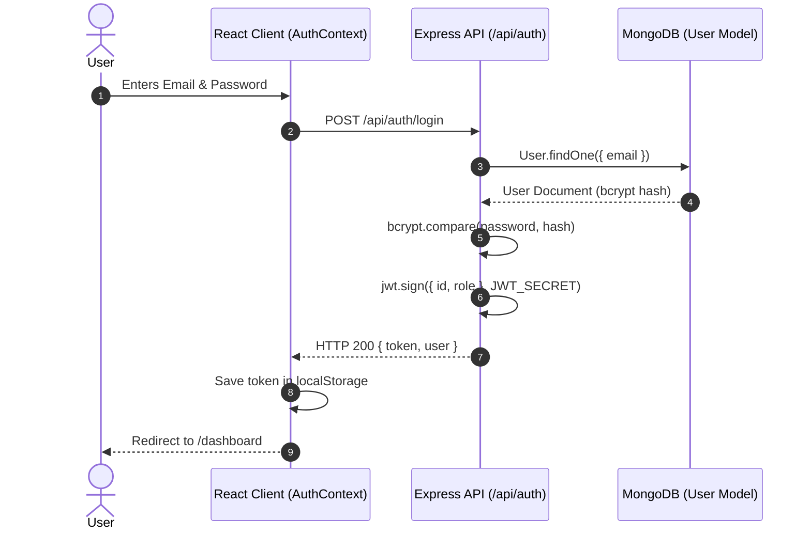

# 🏛️ CineVerse — System Architecture & Data Flow

This document details the software architecture, data pipelines, security boundaries, and operational components of the **CineVerse / Movie Hub** platform.

---

## 1. High-Level System Architecture Diagram

```mermaid
graph TD
    subgraph Client Tier ["Client Tier (Browser)"]
        User["User Browser"]
        SPA["React 19 + Vite SPA"]
        Router["React Router v7 (Lazy Routes)"]
        Contexts["Auth / Movie / Toast Contexts"]
        LocalStore["localStorage (JWT & Theme)"]

        User --> SPA
        SPA --> Router
        SPA --> Contexts
        Contexts <--> LocalStore
    end

    subgraph Edge & Routing Tier ["Edge & Network Tier"]
        ReverseProxy["Reverse Proxy / CDN (Render / Vercel)"]
        SPA -->|HTTPS REST API Calls| ReverseProxy
    end

    subgraph Application Tier ["Application Tier (Node.js 20+ / Express 5)"]
        ExpressServer["Express.js Server (server/app.js)"]
        SecurityMW["Security Middleware (CORS, CSP, Rate Limiter)"]
        AuthMW["Auth Middleware (protect / JWT verify)"]
        Controllers["Controllers (auth, movie, user, watchlist, favorite)"]
        CacheLayer["In-Memory Catalog Cache (10m TTL)"]
        StaticServer["Express Static Asset Server (dist/)"]

        ReverseProxy --> ExpressServer
        ExpressServer --> SecurityMW
        SecurityMW --> Controllers
        SecurityMW --> AuthMW
        AuthMW --> Controllers
        ExpressServer --> StaticServer
        Controllers <--> CacheLayer
    end

    subgraph Data Tier ["Data Tier & External Services"]
        MongoDB["MongoDB 7.0+ (Mongoose ODM)"]
        TMDB["The Movie Database (TMDB v3 API)"]
        YouTube["YouTube Embedded Trailer Service"]

        Controllers -->|Read / Write (Mongoose Models)| MongoDB
        CacheLayer -->|Outbound HTTPS (Axios)| TMDB
        User -->|Sandboxed Iframe Playback| YouTube
    end
```

---

## 2. Core Operational Data Flows

### A. Authentication & Session Flow
1. **User Sign Up / Login**:
   - User submits credentials (`email`, `password`) to `/api/auth/register` or `/api/auth/login`.
   - Express applies `authLimiter` (sliding-window rate limiter) to mitigate credential stuffing.
   - For registration: `User` model schema executes bcrypt pre-save hook with salt factor 10.
   - For login: Password hash is verified using `bcrypt.compare`.
   - On success: Node.js generates a signed JWT payload `{ id, role }` using `JWT_SECRET` with 30-day expiration.
2. **Session Persistence**:
   - Token is stored in browser `localStorage` (`cineverse_token`).
   - On page load / refresh: `AuthContext` executes `GET /api/auth/me` with `Authorization: Bearer <token>`.
   - `authMiddleware.js` extracts, verifies, and decodes the JWT, querying MongoDB for user profile (excluding `password` field).



---

### B. Movie Discovery & Resilient Catalog Flow
1. **Catalog Request**:
   - Client requests collection (e.g. `/api/movies/popular` or `/api/movies/search?query=Inception`).
   - `tmdbService.js` checks the in-memory cache using key `${endpoint}_${params}`.
2. **Cache Hit**: Returns cached JSON payload under 20ms response time.
3. **Cache Miss**:
   - Sends outbound request to `https://api.themoviedb.org/3/` with `TMDB_API_KEY`.
   - On successful response: Stores payload in cache for 10 minutes (`CACHE_TTL_MS`) and responds to client.
4. **Upstream Failure / Offline Resilience**:
   - If TMDB rate limit (HTTP 429) is exceeded, network times out (3500ms timeout), or no API key is configured:
   - System catches the error and seamlessly serves the curated local catalog from `server/data/seedMovies.js`.
   - Client experiences 0% downtime and receives a full, functional movie payload.

---

### C. Personalization Flow (Watchlist, Favorites, History)
1. **Action Trigger**: User clicks "+ Watchlist" or "Favorite" button on any movie card or detail view.
2. **Client Dispatch**: `watchlistService.js` sends authenticated `POST /api/watchlist` with `{ movieId, movieTitle, posterPath }`.
3. **Server Validation**:
   - `protect` middleware extracts `req.user._id` from validated JWT.
   - `Watchlist.create({ userId: req.user._id, movieId, ... })` is invoked.
   - Unique compound index `{ userId: 1, movieId: 1 }` prevents duplicate entries at the database engine level.
4. **Multi-Tenant Isolation**: Queries strictly enforce `{ userId: req.user._id }`, preventing User A from seeing or modifying User B's records.

---

## 3. Error Handling & Resilience Architecture
- **Centralized Error Handling**: `server/middleware/errorMiddleware.js` intercepts all Express errors.
- **Sanitized Client Responses**: In production, raw database stack traces and internal errors are suppressed; client receives `{ success: false, message: "..." }`.
- **SPA Fallback**: Express catches all non-API GET requests and serves `dist/index.html`, allowing React Router to handle deep-linked client routes (`/movie/:id`, `/category/:industry`) without 404 errors.
- **Observability Endpoints**:
  - `/api/health`: Instant liveness check reporting uptime.
  - `/api/ready`: Readiness check confirming active MongoDB connection state (`readyState === 1`).

---

## 4. Security Boundaries
| Layer | Security Controls |
| :--- | :--- |
| **HTTP Boundary** | CORS origin allowlist (`CLIENT_URL`), CSP, X-Frame-Options, HSTS, X-Content-Type-Options |
| **API Boundary** | Sliding-window IP rate limiting (`apiLimiter`, `authLimiter`), JSON payload limit (1MB) |
| **Authentication** | Salted bcrypt password hashes, signed JWT verification, 30-day token expiry |
| **Data Boundary** | MongoDB compound unique constraints, Mongoose schema validation, `toJSON` password stripping |
| **Secrets Boundary** | Zero secrets in client builds; server-only secrets loaded strictly via environment variables |
