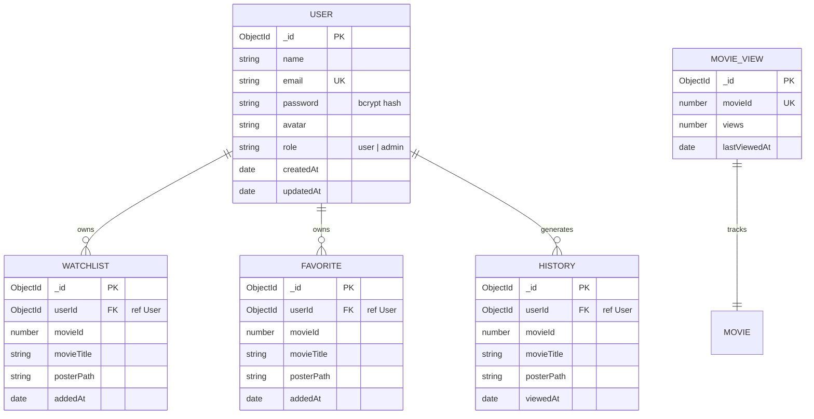

# 🗄️ CineVerse — Database Architecture & Schema Specification

CineVerse utilizes **MongoDB 7.0+** managed via the **Mongoose ODM (Object Data Modeling)** framework.

---

## 1. Entity Relationship Overview



---

## 2. Collection Schemas in Detail

### Collection: `users` ([server/models/User.js](file:///c:/Users/Mubashirhussensk/OneDrive/Desktop/Movie_app/server/models/User.js))
Stores registered user accounts, salted password hashes, and authorization roles.

| Field | Type | Required | Constraints / Defaults | Description |
| :--- | :--- | :--- | :--- | :--- |
| `_id` | `ObjectId` | Auto | Primary Key | Unique document identifier |
| `name` | `String` | Yes | `trim: true` | User's full display name |
| `email` | `String` | Yes | `unique: true, lowercase: true, trim: true`, regex validated | User's unique login email |
| `password` | `String` | Yes | `minlength: 6` | Bcrypt password hash (salt factor 10) |
| `avatar` | `String` | No | Default Unsplash avatar URL | User profile picture URL |
| `role` | `String` | No | `enum: ['user', 'admin']`, default: `'user'` | Role-based authorization tier |
| `createdAt` | `Date` | Auto | Managed by Mongoose `timestamps: true` | Account registration timestamp |
| `updatedAt` | `Date` | Auto | Managed by Mongoose `timestamps: true` | Last profile update timestamp |

**Indexes**:
- `{ email: 1 }` (`unique: true`) — Fast $O(1)$ user lookup and duplicate prevention.

**Security Hooks**:
- `pre('save')`: Hashes plaintext password using `bcrypt.genSalt(10)` prior to persistence if modified.
- `toJSON`: Intercepts document serialization to strip `password` and `__v` from all API payloads.

---

### Collection: `watchlists` ([server/models/Watchlist.js](file:///c:/Users/Mubashirhussensk/OneDrive/Desktop/Movie_app/server/models/Watchlist.js))
Stores user-curated bookmarked movies for future viewing.

| Field | Type | Required | Constraints / Defaults | Description |
| :--- | :--- | :--- | :--- | :--- |
| `_id` | `ObjectId` | Auto | Primary Key | Unique entry identifier |
| `userId` | `ObjectId` | Yes | `ref: 'User'` | Reference to parent `User` document |
| `movieId` | `Number` | Yes | Integer | TMDB / Catalog movie ID |
| `movieTitle`| `String` | Yes | String | Cached movie title for fast rendering |
| `posterPath`| `String` | No | Default: `""` | Cached poster path for offline display |
| `addedAt` | `Date` | No | Default: `Date.now` | Bookmark timestamp |

**Indexes**:
- Compound Unique Index: `{ userId: 1, movieId: 1 }` (`unique: true`)
  - Ensures a user can never add the same movie to their watchlist more than once.
  - Ensures fast queries when checking `isBookmarked` for a specific movie.

---

### Collection: `favorites` ([server/models/Favorite.js](file:///c:/Users/Mubashirhussensk/OneDrive/Desktop/Movie_app/server/models/Favorite.js))
Stores user's top recommended / starred movies.

| Field | Type | Required | Constraints / Defaults | Description |
| :--- | :--- | :--- | :--- | :--- |
| `_id` | `ObjectId` | Auto | Primary Key | Unique entry identifier |
| `userId` | `ObjectId` | Yes | `ref: 'User'` | Reference to parent `User` document |
| `movieId` | `Number` | Yes | Integer | TMDB / Catalog movie ID |
| `movieTitle`| `String` | Yes | String | Cached movie title |
| `posterPath`| `String` | No | Default: `""` | Cached poster image path |
| `addedAt` | `Date` | No | Default: `Date.now` | Favorited timestamp |

**Indexes**:
- Compound Unique Index: `{ userId: 1, movieId: 1 }` (`unique: true`).

---

### Collection: `histories` ([server/models/History.js](file:///c:/Users/Mubashirhussensk/OneDrive/Desktop/Movie_app/server/models/History.js))
Tracks user's chronological viewing history.

| Field | Type | Required | Constraints / Defaults | Description |
| :--- | :--- | :--- | :--- | :--- |
| `_id` | `ObjectId` | Auto | Primary Key | Unique entry identifier |
| `userId` | `ObjectId` | Yes | `ref: 'User'` | Reference to parent `User` document |
| `movieId` | `Number` | Yes | Integer | TMDB / Catalog movie ID |
| `movieTitle`| `String` | Yes | String | Cached movie title |
| `posterPath`| `String` | No | Default: `""` | Cached poster image path |
| `viewedAt` | `Date` | No | Default: `Date.now` | Last viewed timestamp |

**Indexes**:
- `{ userId: 1, movieId: 1 }` — Enables quick upsert/find operations.
- `{ userId: 1, viewedAt: -1 }` — Optimizes reverse-chronological history sorting.

---

### Collection: `movieviews` ([server/models/MovieView.js](file:///c:/Users/Mubashirhussensk/OneDrive/Desktop/Movie_app/server/models/MovieView.js))
Tracks aggregate platform-wide view counters per title.

| Field | Type | Required | Constraints / Defaults | Description |
| :--- | :--- | :--- | :--- | :--- |
| `_id` | `ObjectId` | Auto | Primary Key | Unique entry identifier |
| `movieId` | `Number` | Yes | `unique: true` | Catalog movie ID |
| `views` | `Number` | No | Default: `0` | Total application view count |
| `lastViewedAt`| `Date` | No | Default: `Date.now` | Last view increment timestamp |

**Indexes**:
- `{ movieId: 1 }` (`unique: true`).

---

## 3. Data Associations & User Isolation
All personalized documents store a strong foreign key reference `userId` corresponding to `User._id`. Every controller query explicitly filters by authenticated user:
```javascript
const items = await Watchlist.find({ userId: req.user._id }).sort({ addedAt: -1 });
```
This guarantees complete tenant isolation; User A cannot access, query, or delete any records owned by User B.

---

## 4. Backup & Disaster Recovery
- **Automated Snapshots**: In MongoDB Atlas, continuous point-in-time backups or daily snapshots are retained for 7 to 30 days.
- **Manual Backups**:
  ```bash
  mongodump --uri="<MONGODB_URI>" --gzip --out="./backups/cineverse_$(date +%Y%m%d)"
  ```
- **Restoration**:
  ```bash
  mongorestore --uri="<MONGODB_URI>" --gzip ./backups/cineverse_<timestamp>
  ```
- **Zero Destructive Migrations**: All schema updates retain backward compatibility with previous records.
