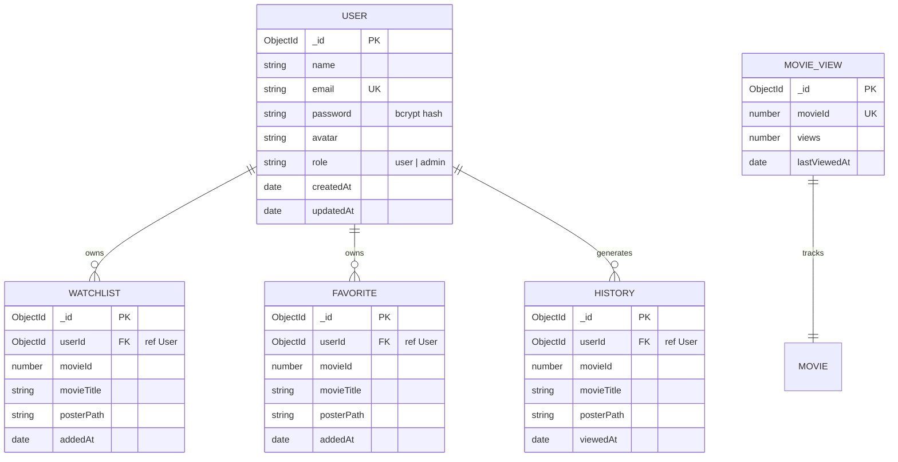

# 🗄️ CineVerse — Database Architecture & Schema Specification

CineVerse utilizes **MongoDB 7.0+** managed via the **Mongoose ODM (Object Data Modeling)** framework.

---

## 1. Entity Relationship Overview



---

## 2. Collection Schemas in Detail

### Collection: `users` ([server/models/User.js](file:///c:/Users/Mubashirhussensk/OneDrive/Desktop/Movie_app/server/models/User.js))
Stores registered user accounts, salted password hashes, and authorization roles.

| Field | Type | Required | Constraints / Defaults | Description |
| :--- | :--- | :--- | :--- | :--- |
| `_id` | `ObjectId` | Auto | Primary Key | Unique document identifier |
| `name` | `String` | Yes | `trim: true` | User's full display name |
| `email` | `String` | Yes | `unique: true, lowercase: true, trim: true`, regex validated | User's unique login email |
| `password` | `String` | Yes | `minlength: 6` | Bcrypt password hash (salt factor 10) |
| `avatar` | `String` | No | Default Unsplash avatar URL | User profile picture URL |
| `role` | `String` | No | `enum: ['user', 'admin']`, default: `'user'` | Role-based authorization tier |
| `createdAt` | `Date` | Auto | Managed by Mongoose `timestamps: true` | Account registration timestamp |
| `updatedAt` | `Date` | Auto | Managed by Mongoose `timestamps: true` | Last profile update timestamp |

**Indexes**:
- `{ email: 1 }` (`unique: true`) — Fast $O(1)$ user lookup and duplicate prevention.

**Security Hooks**:
- `pre('save')`: Hashes plaintext password using `bcrypt.genSalt(10)` prior to persistence if modified.
- `toJSON`: Intercepts document serialization to strip `password` and `__v` from all API payloads.

---

### Collection: `watchlists` ([server/models/Watchlist.js](file:///c:/Users/Mubashirhussensk/OneDrive/Desktop/Movie_app/server/models/Watchlist.js))
Stores user-curated bookmarked movies organized by default viewing status or assigned to user-defined custom lists.

| Field | Type | Required | Constraints / Defaults | Description |
| :--- | :--- | :--- | :--- | :--- |
| `_id` | `ObjectId` | Auto | Primary Key | Unique entry identifier |
| `userId` | `ObjectId` | Yes | `ref: 'User'` | Reference to parent `User` document |
| `customListId` | `ObjectId` | No | `ref: 'CustomWatchlist'`, Default: `null` | Reference to parent custom watchlist (null for default status list) |
| `status` | `String` | No | Enum: `['want_to_watch', 'watching', 'watched']`, Default: `'want_to_watch'` | Viewing status lifecycle stage |
| `movieId` | `Number` | Yes | Integer | TMDB / Catalog movie ID |
| `movieTitle`| `String` | Yes | String | Cached movie title for fast rendering |
| `posterPath`| `String` | No | Default: `""` | Cached poster path for offline display |
| `releaseDate`| `String` | No | Default: `""` | Movie release date |
| `voteAverage`| `Number` | No | Default: `0` | TMDB verified rating score |
| `addedAt` | `Date` | No | Default: `Date.now` | Bookmark timestamp |

**Indexes**:
- Compound Unique Index: `{ userId: 1, movieId: 1, customListId: 1 }` (`unique: true`)
  - Guarantees a movie cannot be duplicated within the same list (default or custom).
  - Permits the identical movie to reside across distinct custom collections and viewing lists.

---

### Collection: `customwatchlists` ([server/models/CustomWatchlist.js](file:///c:/Users/Mubashirhussensk/OneDrive/Desktop/Movie_app/server/models/CustomWatchlist.js))
Stores custom user-created movie collections with user-defined names and optional descriptions.

| Field | Type | Required | Constraints / Defaults | Description |
| :--- | :--- | :--- | :--- | :--- |
| `_id` | `ObjectId` | Auto | Primary Key | Unique list identifier |
| `userId` | `ObjectId` | Yes | `ref: 'User'` | Owner user document reference |
| `name` | `String` | Yes | Max: 100 characters, Trimmed | Unique list name per user |
| `description`| `String` | No | Max: 500 characters, Default: `""` | Curated description of list intent |
| `createdAt`| `Date` | Auto | Timestamp | Creation timestamp |
| `updatedAt`| `Date` | Auto | Timestamp | Last update timestamp |

**Indexes**:
- Compound Unique Index: `{ userId: 1, name: 1 }` (`unique: true`)
  - Prevents a user from creating duplicate lists with identical names, while allowing different users to own lists with the same title.

---

### Collection: `favorites` ([server/models/Favorite.js](file:///c:/Users/Mubashirhussensk/OneDrive/Desktop/Movie_app/server/models/Favorite.js))
Stores user's top recommended / starred movies.

| Field | Type | Required | Constraints / Defaults | Description |
| :--- | :--- | :--- | :--- | :--- |
| `_id` | `ObjectId` | Auto | Primary Key | Unique entry identifier |
| `userId` | `ObjectId` | Yes | `ref: 'User'` | Reference to parent `User` document |
| `movieId` | `Number` | Yes | Integer | TMDB / Catalog movie ID |
| `movieTitle`| `String` | Yes | String | Cached movie title |
| `posterPath`| `String` | No | Default: `""` | Cached poster image path |
| `addedAt` | `Date` | No | Default: `Date.now` | Favorited timestamp |

**Indexes**:
- Compound Unique Index: `{ userId: 1, movieId: 1 }` (`unique: true`).

---

### Collection: `histories` ([server/models/History.js](file:///c:/Users/Mubashirhussensk/OneDrive/Desktop/Movie_app/server/models/History.js))
Tracks user's chronological viewing history.

| Field | Type | Required | Constraints / Defaults | Description |
| :--- | :--- | :--- | :--- | :--- |
| `_id` | `ObjectId` | Auto | Primary Key | Unique entry identifier |
| `userId` | `ObjectId` | Yes | `ref: 'User'` | Reference to parent `User` document |
| `movieId` | `Number` | Yes | Integer | TMDB / Catalog movie ID |
| `movieTitle`| `String` | Yes | String | Cached movie title |
| `posterPath`| `String` | No | Default: `""` | Cached poster image path |
| `viewedAt` | `Date` | No | Default: `Date.now` | Last viewed timestamp |

**Indexes**:
- `{ userId: 1, movieId: 1 }` — Enables quick upsert/find operations.
- `{ userId: 1, viewedAt: -1 }` — Optimizes reverse-chronological history sorting.

---

### Collection: `movieviews` ([server/models/MovieView.js](file:///c:/Users/Mubashirhussensk/OneDrive/Desktop/Movie_app/server/models/MovieView.js))
Tracks aggregate platform-wide view counters per title.

| Field | Type | Required | Constraints / Defaults | Description |
| :--- | :--- | :--- | :--- | :--- |
| `_id` | `ObjectId` | Auto | Primary Key | Unique entry identifier |
| `movieId` | `Number` | Yes | `unique: true` | Catalog movie ID |
| `views` | `Number` | No | Default: `0` | Total application view count |
| `lastViewedAt`| `Date` | No | Default: `Date.now` | Last view increment timestamp |

**Indexes**:
### Collection: `ratings` ([server/models/Rating.js](file:///c:/Users/Mubashirhussensk/OneDrive/Desktop/Movie_app/server/models/Rating.js))
Stores user star ratings (1–5 scale).

| Field | Type | Required | Constraints / Defaults | Description |
| :--- | :--- | :--- | :--- | :--- |
| `_id` | `ObjectId` | Auto | Primary Key | Unique entry identifier |
| `userId` | `ObjectId` | Yes | `ref: 'User'` | Reference to rating author |
| `movieId` | `Number` | Yes | Integer | TMDB / Catalog movie ID |
| `rating` | `Number` | Yes | `min: 1, max: 5` | Integer star rating score |
| `createdAt`| `Date` | Auto | Managed by Mongoose | Initial rating timestamp |
| `updatedAt`| `Date` | Auto | Managed by Mongoose | Last rating modification |

**Indexes**:
- Compound Unique Index: `{ userId: 1, movieId: 1 }` (`unique: true`) — Guarantees only 1 active rating per user per movie.
- Index: `{ movieId: 1 }` — Enables fast aggregation of community averages and distributions.

---

### Collection: `reviews` ([server/models/Review.js](file:///c:/Users/Mubashirhussensk/OneDrive/Desktop/Movie_app/server/models/Review.js))
Stores user text reviews, optional attached ratings, spoiler flags, and helpful vote arrays.

| Field | Type | Required | Constraints / Defaults | Description |
| :--- | :--- | :--- | :--- | :--- |
| `_id` | `ObjectId` | Auto | Primary Key | Unique review identifier |
| `userId` | `ObjectId` | Yes | `ref: 'User'` | Reference to review author |
| `movieId` | `Number` | Yes | Integer | TMDB / Catalog movie ID |
| `rating` | `Number` | No | `min: 1, max: 5`, default: `null` | Star rating associated with review |
| `reviewText`| `String` | Yes | `minlength: 5, maxlength: 1000` | Sanitized review body |
| `isSpoiler`| `Boolean` | No | Default: `false` | True if review contains spoilers |
| `helpfulVotes`| `[ObjectId]`| No | Array of `ref: 'User'` | Users who found review helpful |
| `helpfulCount`| `Number` | No | Default: `0` | Total helpful votes counter |
| `reportCount` | `Number` | No | Default: `0` | Moderation report counter |
| `status` | `String` | No | `enum: ['approved', 'flagged', 'hidden']` | Content moderation status |

**Indexes**:
- `{ movieId: 1, status: 1, createdAt: -1 }` — Optimizes newest reviews retrieval.
- `{ movieId: 1, helpfulCount: -1 }` — Optimizes most helpful reviews retrieval.
- `{ movieId: 1, rating: -1 }` — Optimizes highest-rated reviews retrieval.
- Compound Index: `{ userId: 1, movieId: 1 }` — Fast lookup for user's own review.

---

### Collection: `reviewreports` ([server/models/ReviewReport.js](file:///c:/Users/Mubashirhussensk/OneDrive/Desktop/Movie_app/server/models/ReviewReport.js))
Tracks community moderation reports for inappropriate or spoiler content.

| Field | Type | Required | Constraints / Defaults | Description |
| :--- | :--- | :--- | :--- | :--- |
| `_id` | `ObjectId` | Auto | Primary Key | Unique report identifier |
| `reviewId` | `ObjectId` | Yes | `ref: 'Review'` | Reference to reported review |
| `reportedBy`| `ObjectId` | Yes | `ref: 'User'` | Reference to reporting user |
| `reason` | `String` | Yes | `enum: ['harassment', 'spam', 'hate_speech', 'unmarked_spoiler', 'other']` | Violation category |
| `details` | `String` | No | Max 500 chars | Optional context for moderators |

**Indexes**:
- Compound Unique Index: `{ reviewId: 1, reportedBy: 1 }` (`unique: true`) — Prevents duplicate reports by the same user.

---

## 3. Data Associations & User Isolation
All personalized documents store a strong foreign key reference `userId` corresponding to `User._id`. Every controller query explicitly filters by authenticated user:
```javascript
const items = await Watchlist.find({ userId: req.user._id }).sort({ addedAt: -1 });
```
This guarantees complete tenant isolation; User A cannot access, query, or delete any records owned by User B.

---

## 4. Backup & Disaster Recovery
- **Automated Snapshots**: In MongoDB Atlas, continuous point-in-time backups or daily snapshots are retained for 7 to 30 days.
- **Manual Backups**:
  ```bash
  mongodump --uri="<MONGODB_URI>" --gzip --out="./backups/cineverse_$(date +%Y%m%d)"
  ```
- **Restoration**:
  ```bash
  mongorestore --uri="<MONGODB_URI>" --gzip ./backups/cineverse_<timestamp>
  ```
- **Zero Destructive Migrations**: All schema updates retain backward compatibility with previous records.
