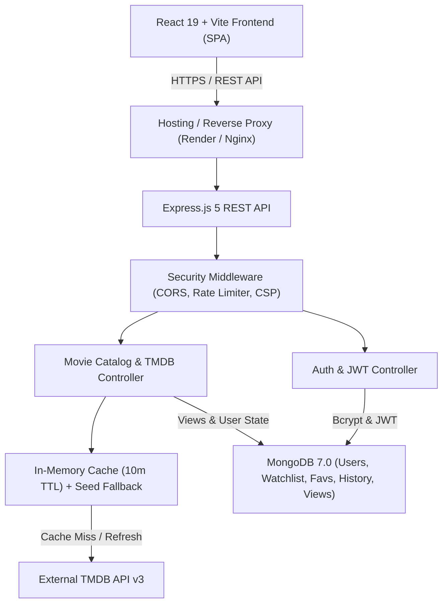

# 🎬 CineVerse — Full-Stack Movie Discovery & Personalization Platform

A production-grade, full-stack web application for discovering movies, exploring cast & crew, watching trailers, checking verified streaming availability (Netflix, Amazon Prime Video, JioHotstar, etc.), and managing personal watchlists, favorites, and viewing history.

Built with **React 19 (Vite)**, **Node.js 20+**, **Express.js**, **MongoDB / Mongoose**, and **The Movie Database (TMDB) API v3**.

---

## 1. Project Title & Summary
**CineVerse** (`movie_hub`) is an end-to-end, full-stack movie discovery and streaming guidance web application. It bridges the gap between external entertainment APIs and personalized user experiences by providing real-time catalog discovery, resilient caching, trailer playback, deep media metadata, and secure multi-tenant user personalization.

---

## 2. Problem Statement
Movie enthusiasts frequently struggle to find comprehensive, reliable information about trending films, where they are officially streaming in their region, what trailers exist, and who stars in them, all in one cohesive, clutter-free interface. Many third-party movie platforms either lack direct streaming provider links, fail when external rate limits are exceeded, or do not provide persistent user watchlists and viewing history with strict data privacy.

---

## 3. Objectives
- **Centralized Movie Discovery**: Provide instant browsing across Popular, Top-Rated, Upcoming, Now Playing, and industry categories (Hollywood, Bollywood, Anime, Korean, etc.).
- **Reliable Fallbacks & Caching**: Implement multi-tier server-side caching (10-minute TTL) and curated catalog fallback so the application never breaks during upstream API outages.
- **Rich Media & Streaming Links**: Embed sandboxed YouTube trailers and verified streaming provider deep-links.
- **Secure Authentication & Personalization**: Offer JWT authentication with bcrypt password hashing and user-isolated Watchlist, Favorites, and Viewing History.
- **Production Readiness & CI/CD**: Deliver high-performance assets, robust security headers, automated GitHub Actions CI/CD workflows, and 100% passing regression test coverage.

---

## 4. Implemented Features
- 🌟 **Dynamic Cinematic Hero Spotlight**: High-impact trending release showcase with immediate trailer modal launch.
- 🔍 **Debounced Search & Discovery Filters**: Live search input with 400ms debounce, industry pills, and genre taxonomy filtering.
- 🎬 **Deep Movie Details View**:
  - High-definition official studio posters with fallback placeholder handling.
  - Runtime, release date, rating badge (`⭐ 8.3/10`), tagline, and synopsis.
  - Verified streaming providers (Netflix, Prime Video, Apple TV, JioHotstar, etc.).
  - Budget, box office revenue, and atomic application view counter.
  - Filtered cast & character profiles, related recommendations, and similar titles.
- 🍿 **Sandboxed Media Hub**: In-page YouTube trailer modal with keyboard `Escape` closing, focus trap, and multi-server preview embed.
- 🔐 **JWT Authentication & Profile Management**:
  - Registration, login, session restoration via `/api/auth/me`.
  - Password encryption using salted bcrypt hashes (work factor 10).
  - Profile avatar selection and user profile management.
- 📋 **Personalized Library**:
  - Multi-tenant isolated Watchlists, Favorites, and chronological Viewing History.
  - Compound unique indexing preventing duplicate entries.
- 🛡️ **Defensive Security Controls**:
  - Security headers (CSP, HSTS, X-Content-Type-Options, X-Frame-Options).
  - Strict CORS origin allowlisting.
  - Sliding-window in-memory rate limiting with test/dev loopback exemptions.
  - Sanitized API error handlers preventing stack trace leakage.
- ⚡ **Performance & Accessibility**:
  - Lazy-loaded route chunks via `React.lazy` and `Suspense`.
  - Responsive image rendering with `loading="lazy"` and `decoding="async"`.
  - Accessible form labels, aria attributes, and keyboard navigation.

---

## 5. Actual Technology Stack
- **Frontend**: React 19, Vite 8, React Router DOM 7, Framer Motion 14, Lucide React icons, Vanilla CSS.
- **Backend API**: Node.js 20+, Express.js 5.
- **Database**: MongoDB 7.0+ with Mongoose 8.
- **External Integration**: TMDB API v3 via Axios with in-memory TTL caching.
- **Authentication**: JSON Web Tokens (jsonwebtoken) & bcryptjs.
- **CI/CD & DevOps**: GitHub Actions, Docker, Docker Compose, Dependabot.
- **Hosting Targets**: Render (unified web service or backend), Vercel/Netlify (static frontend SPA).

---

## 6. System Architecture



---

## 7. Project Directory Structure
```
Movie_app/
├── .github/
│   ├── dependabot.yml              # Dependabot security scanning config
│   └── workflows/
│       ├── ci.yml                  # GitHub Actions continuous integration
│       ├── deploy-staging.yml      # Staging automated deployment
│       └── deploy-production.yml   # Production release workflow
├── server/
│   ├── app.js                      # Express application setup & middleware
│   ├── server.js                   # Server bootstrap & production validator
│   ├── config/                     # DB & industry categorization configs
│   ├── controllers/                # Auth, movie, people, user controllers
│   ├── data/                       # Curated offline seed catalog
│   ├── middleware/                 # Auth, admin, security, error, rate limit
│   ├── models/                     # User, Watchlist, Favorite, History, MovieView
│   ├── routes/                     # Express REST route endpoints
│   └── services/                   # TMDB integration with caching
├── src/
│   ├── App.jsx                     # Top-level routing & layout shell
│   ├── main.jsx                    # React 19 DOM bootstrap
│   ├── components/                 # Reusable UI components & modals
│   ├── context/                    # AuthContext, MovieContext, ToastContext
│   ├── pages/                      # Route pages (Home, Search, Details, etc.)
│   └── services/                   # Frontend Axios API client & services
├── public/                         # Static assets & Netlify _redirects
├── DEPLOYMENT_RUNBOOK.md           # Operational runbook & incident guides
├── Dockerfile                      # Production multi-stage Docker build
├── docker-compose.yml              # Multi-container orchestration
├── package.json                    # Monorepo dependencies & scripts
├── render.yaml                     # Infrastructure-as-code Render blueprint
├── vercel.json                     # Vercel SPA rewrite configuration
└── vite.config.js                  # Vite production asset configuration
```

---

## 8. Database Design
MongoDB schemas managed via Mongoose:
- **`User`**: `_id`, `name`, `email` (unique, lowercase), `password` (bcrypt hash), `avatar`, `role`, timestamps.
- **`Watchlist`**: `_id`, `userId` (ref User), `movieId` (Number), `movieTitle`, `posterPath`, `addedAt`. Unique compound index: `{ userId: 1, movieId: 1 }`.
- **`Favorite`**: `_id`, `userId` (ref User), `movieId` (Number), `movieTitle`, `posterPath`, `addedAt`. Unique compound index: `{ userId: 1, movieId: 1 }`.
- **`History`**: `_id`, `userId` (ref User), `movieId`, `movieTitle`, `posterPath`, `viewedAt`. Indexes: `{ userId: 1, movieId: 1 }` and `{ userId: 1, viewedAt: -1 }`.
- **`MovieView`**: `_id`, `movieId` (unique Number), `views` (Number), `lastViewedAt`.

---

## 9. API Endpoints Reference
| Method | Endpoint | Description | Auth Required |
| :--- | :--- | :--- | :--- |
| `GET` | `/api/health` | Service liveness health check probe | No |
| `GET` | `/api/ready` | Service readiness probe (MongoDB check) | No |
| `POST` | `/api/auth/register` | Register new user account | No |
| `POST` | `/api/auth/login` | Authenticate user & issue JWT | No |
| `GET` | `/api/auth/me` | Fetch active user profile | **Yes** (Bearer Token) |
| `GET` | `/api/movies/popular` | Retrieve popular movies catalog | No |
| `GET` | `/api/movies/top-rated` | Retrieve top-rated movies catalog | No |
| `GET` | `/api/movies/upcoming` | Retrieve upcoming movies catalog | No |
| `GET` | `/api/movies/now-playing` | Retrieve now-playing movies catalog | No |
| `GET` | `/api/movies/genres` | Retrieve movie genre taxonomy | No |
| `GET` | `/api/movies/search?query=` | Search movies by title keyword | No |
| `GET` | `/api/movies/industry/:name` | Filter by industry (hollywood, bollywood, etc.) | No |
| `GET` | `/api/movies/:id` | Full movie details & view count | No |
| `GET` | `/api/movies/:id/cast` | Full cast and crew credits | No |
| `GET` | `/api/movies/:id/trailer` | Official trailers and preview video keys | No |
| `GET` | `/api/movies/:id/providers` | Streaming availability providers | No |
| `POST` | `/api/movies/:id/view` | Atomically increment application view count | No |
| `GET` | `/api/watchlist` | Retrieve user watchlist items | **Yes** |
| `POST` | `/api/watchlist` | Add movie to user watchlist | **Yes** |
| `DELETE` | `/api/watchlist/:movieId` | Remove movie from user watchlist | **Yes** |
| `GET` | `/api/favorites` | Retrieve user favorite movies | **Yes** |
| `POST` | `/api/favorites` | Add movie to user favorites | **Yes** |
| `DELETE` | `/api/favorites/:movieId` | Remove movie from user favorites | **Yes** |
| `GET` | `/api/history` | Retrieve chronological watch history | **Yes** |
| `POST` | `/api/history` | Record movie viewing in history | **Yes** |
| `DELETE` | `/api/history/:movieId` | Remove entry from viewing history | **Yes** |

---

## 10. Environment Variable Setup
Copy `.env.example` to `.env`:
```bash
cp .env.example .env
```
Populate required environment variables:
```env
NODE_ENV=development
PORT=5000
MONGODB_URI=mongodb://127.0.0.1:27017/cineverse
JWT_SECRET=your_jwt_secret_key_minimum_32_characters_long
TMDB_API_KEY=your_tmdb_api_v3_key
CLIENT_URL=http://localhost:5173
VITE_API_BASE_URL=/api
```

---

## 11. Local Installation Instructions
1. **Clone the repository**:
   ```bash
   git clone https://github.com/mubashirhussen/movie_hub.git
   cd movie_hub
   ```
2. **Install dependencies**:
   ```bash
   npm ci
   ```
3. **Verify local MongoDB**: Ensure MongoDB is running locally on port 27017 or provide a MongoDB Atlas URI in `.env`.

---

## 12. Development & Production Commands
- **Run Full-Stack in Development**:
  ```bash
  npm run dev
  ```
  *(Launches Vite dev server on `http://localhost:5173` and Express on `http://localhost:5000`)*
- **Run Backend API Only**:
  ```bash
  npm run server
  ```
- **Run Frontend Client Only**:
  ```bash
  npm run client
  ```
- **Build Client for Production**:
  ```bash
  npm run build
  ```
- **Start Production Server**:
  ```bash
  npm start
  ```

---

## 13. Testing Instructions
CineVerse includes a self-bootstrapping master regression runner covering all development phases and production stages:
- **Run Master Regression Test Suite (All 11 Suites)**:
  ```bash
  npm test
  ```
- **Run Specific Verification Suites**:
  ```bash
  npm run test:e2e       # Stage 2: End-to-end user journeys
  npm run test:security  # Stage 3: Security & authorization
  npm run test:stage4    # Stage 4: Performance & accessibility
  npm run test:deploy    # Stage 5: Deployment readiness
  npm run test:stage7    # Stage 7: CI/CD pipeline verification
  npm run test:stage8    # Stage 8: Final acceptance test suite
  ```
- **Run Dependency Security Audit**:
  ```bash
  npm run audit
  ```

---

## 14. Deployment Instructions
- **Unified Hosting (Render)**:
  1. Link GitHub repository to Render Web Service.
  2. Set Build Command: `npm run build`.
  3. Set Start Command: `npm start`.
  4. Set Health Check Path: `/api/health`.
  5. Add environment variables: `NODE_ENV=production`, `MONGODB_URI`, `JWT_SECRET`, `TMDB_API_KEY`.
- **Decoupled Hosting (Frontend on Vercel / Backend on Render)**:
  1. Frontend: Deploy root to Vercel. `vercel.json` ensures all SPA routes rewrite to `/index.html`. Set `VITE_API_BASE_URL=https://<your-render-backend>/api`.
  2. Backend: Set `CLIENT_URL=https://<your-vercel-domain>`.

---

## 15. Security & Privacy Considerations
- **No Hardcoded Secrets**: Secrets are loaded exclusively from environment variables.
- **Password Protection**: Passwords are never stored in plaintext and never serialized in API responses (`toJSON` schema hook).
- **Multi-Tenant Isolation**: All user resources (Watchlist, Favorites, History) enforce `req.user._id` ownership checks.
- **Rate Limiting**: Sliding-window limiter mitigates brute-force attacks on `/api/auth`.
- **Security Headers**: Helmet-equivalent CSP, framing prevention, and strict referrer policies.

---

## 16. Known Limitations
- TMDB API v3 has an external rate limit (40 requests per 10 seconds). CineVerse mitigates this through in-memory TTL caching and offline fallback seed data.
- Full video playback relies on external embed services (YouTube official trailers). If a film has no public YouTube trailer, a fallback cinematic placeholder is presented.

---

## 17. Future Improvements (Stage 9 Roadmap)
- Personalized machine learning recommendation engine based on user watch history and rating vectors.
- User reviews, star ratings, and community discussion threads.
- Filter by specific streaming subscription providers (e.g. "Only show movies available on Netflix").
- Social profiles and shareable custom watchlists.
